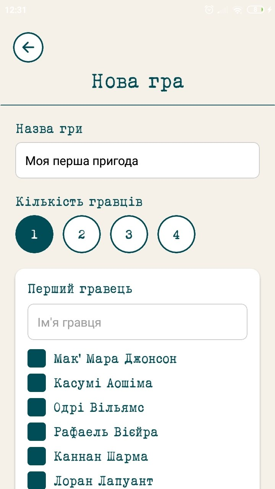
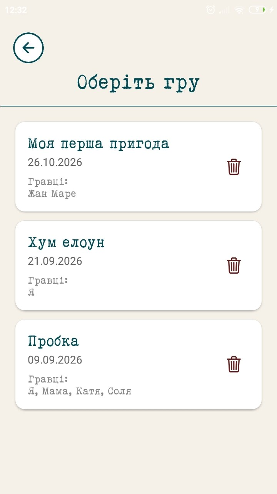
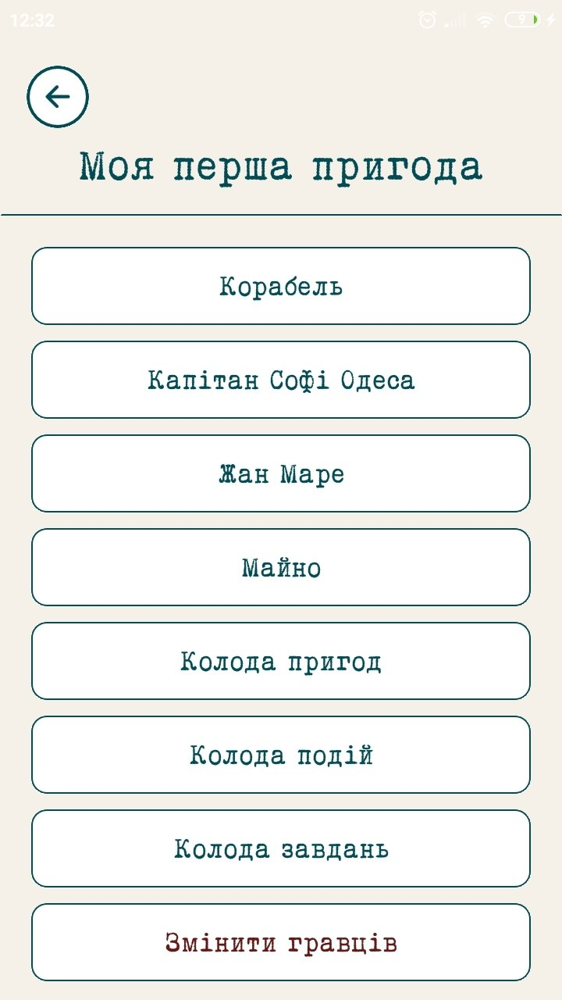
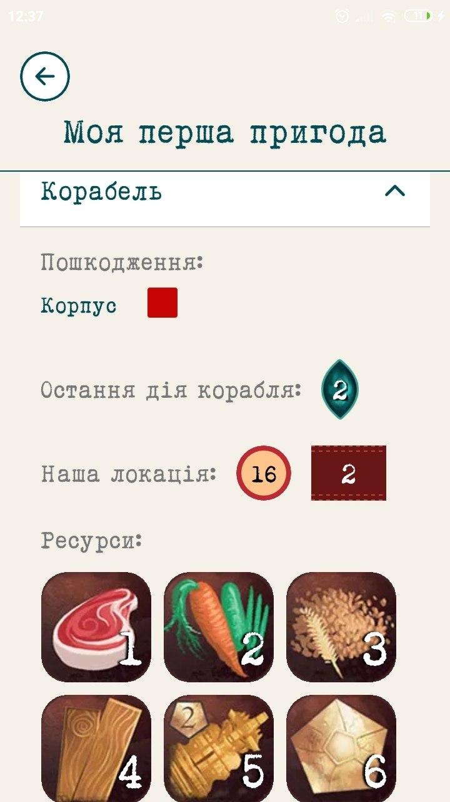
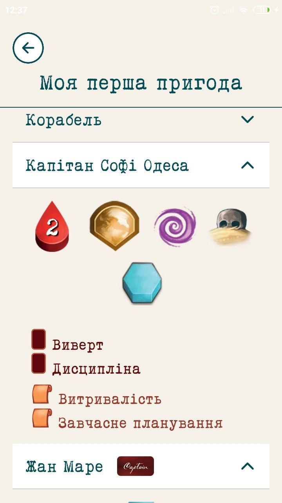

# Save Gods

A mobile companion app for the *Sleeping Gods* cooperative board game, built with React Native, Expo and TypeScript.

## Download

**[Download the latest Android APK](https://github.com/Yig-or-Moroz/Save-Gods/releases/latest)**

1. Download the `.apk` file from the latest release.
2. Open the downloaded file on your Android device.
3. Allow installation from this source if Android requests permission.
4. Follow the on-screen instructions to install the app.

## Screenshots

<!-- Add screenshots of the actual application here. -->

  
  
  

  
  
  

## Features

- Save and restore board game progress.
- Local data storage.
- Mobile interface built with React Native.

## Tech Stack

- React Native
- Expo
- TypeScript
- SQLite

## About

Save Gods is a personal project focused on mobile application development and providing a convenient way to manage board game progress.

## Author

**Ihor Moroz**

[GitHub Profile](https://github.com/Yig-or-Moroz) · [Source Code](https://github.com/Yig-or-Moroz/Save-Gods)